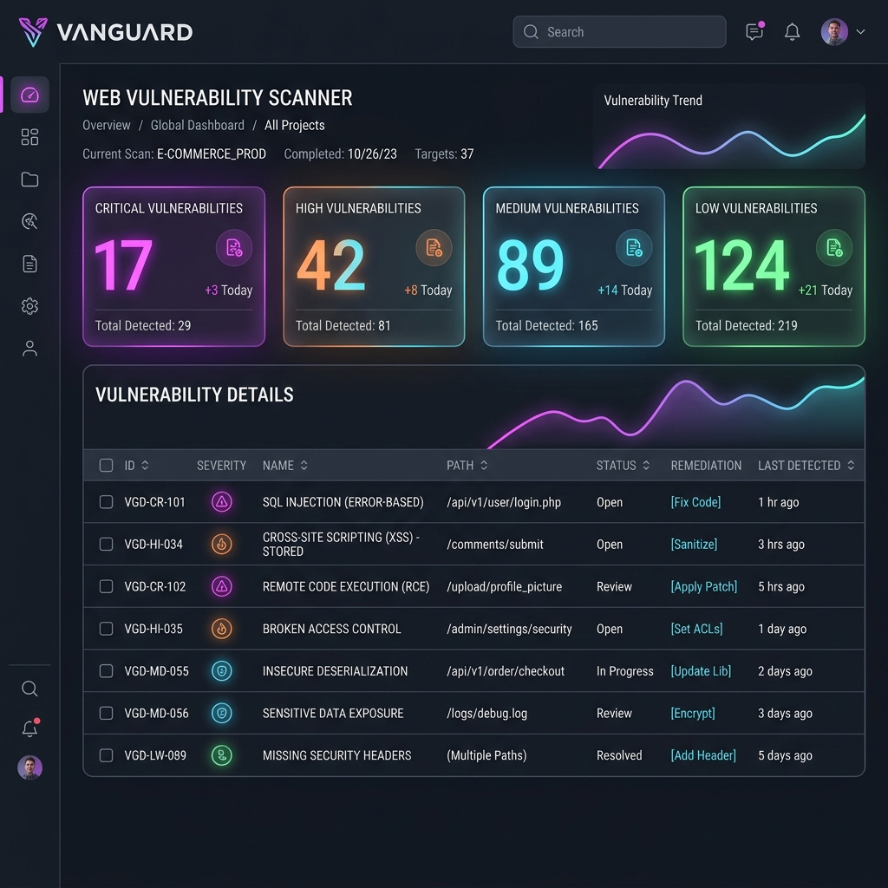
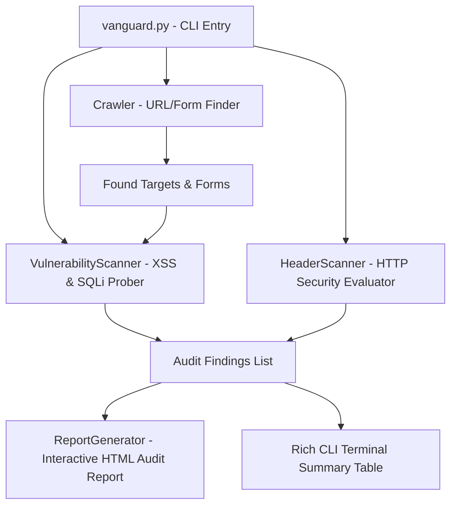

# Vanguard: Automated Web Vulnerability Scanner & Recon Tool 🛡️

[](https://www.python.org/)
[](https://opensource.org/licenses/MIT)
[]()

**Vanguard** is a premium, modular command-line vulnerability scanner designed for ethical hackers, security analysts, and developers. It crawls target websites, evaluates HTTP response security headers, and tests endpoints/forms for critical vulnerabilities such as **Cross-Site Scripting (XSS)** and **SQL Injection (SQLi)**. It then compiles the results into a stunning, responsive, dark-mode **HTML report** for audit documentation.

---

## 📸 Report Dashboard Preview

Below is a preview of the interactive HTML report generated by Vanguard:



---

## ✨ Features

- **🌐 Target Crawling & Mapping**: Recursively crawls domains up to a configurable depth to discover hidden endpoints, URLs, and active HTML forms.
- **🔒 Security Header Audit**: Evaluates HTTP response headers for missing configurations (`CSP`, `X-Frame-Options`, `HSTS`, `X-Content-Type-Options`) and flags dangerous information disclosures (e.g. `Server` or `X-Powered-By`).
- **⚔️ Active Vulnerability Probing**:
  - **Cross-Site Scripting (XSS)**: Performs active injection in query parameters and forms to check for reflections and lack of HTML escaping.
  - **SQL Injection (SQLi)**: Injects SQL syntax payloads and monitors server responses for common database driver error signatures.
- **🎨 Stunning CLI Dashboard**: Features real-time scanning loaders, tables, and color-coded severities utilizing the `rich` library.
- **📄 Premium HTML Report**: Generates an interactive, modern, CSS-styled HTML report featuring statistics, interactive accordions, and detailed remediation advice for every vulnerability found.

---

## 🛠️ Architecture



---

## 🚀 Installation & Setup

### 1. Clone the Repository
```bash
git clone https://github.com/Neeshant01/vanguard-scanner.git
cd vanguard-scanner
```

### 2. Set Up a Virtual Environment (Recommended)
This avoids the `externally-managed-environment` error commonly found in systems like Kali Linux or Debian:
```bash
python3 -m venv venv
source venv/bin/activate  # On Windows: venv\Scripts\activate
```

### 3. Install Dependencies
```bash
pip install -r requirements.txt
```

---

## 💻 Usage

To run a default scan on a target website:
```bash
python vanguard.py https://example.com
```

### Advanced Flags:
| Flag | Long Flag | Description | Default |
| :--- | :--- | :--- | :--- |
| `-h` | `--help` | Show help menu and options | - |
| `-o` | `--output` | Customize the filepath of the generated HTML report | `vanguard_report.html` |
| `-d` | `--depth` | Maximum number of URLs to crawl and audit | `15` |

### Scanning Example (HTTP-only targets):
```bash
python vanguard.py http://testphp.vulnweb.com -o audit_report.html -d 20
```

---

## ⚠️ Troubleshooting & Common Errors

Here are some common errors you might encounter and how to solve them:

### 1. `externally-managed-environment` error during `pip install`
* **Why it happens**: Debian/Ubuntu/Kali Linux prevents system-wide package installs to protect the OS configuration (PEP 668).
* **Fix**: Always create and activate a Python virtual environment (venv) before installing requirements:
  ```bash
  python3 -m venv venv
  source venv/bin/activate
  pip install -r requirements.txt
  ```

### 2. `Connection Error` / `Failed to connect` in findings
* **Why it happens**: You scanned a target that does not support HTTPS/SSL, or the server is down, or there is a local firewall blocking requests.
* **Fix**: Check if the website runs on plain HTTP instead of HTTPS. Specify the correct protocol in the command line:
  * For HTTP: `python vanguard.py http://target.com`
  * For HTTPS: `python vanguard.py https://target.com`

### 3. `ModuleNotFoundError: No module named 'rich'` (or other modules)
* **Why it happens**: Python is running outside of your virtual environment, or requirements were not successfully installed.
* **Fix**: Make sure you see `(venv)` at the beginning of your terminal prompt. If not, activate it:
  ```bash
  source venv/bin/activate
  ```

### 4. Zero Pages Crawled or Forms Found on a JavaScript-heavy App
* **Why it happens**: Vanguard uses lightweight HTML parsing (`BeautifulSoup`). It cannot execute complex JavaScript frameworks (like React/Angular) to render client-side links.
* **Fix**: This scanner is optimized for standard server-rendered HTML applications. For heavy JS applications, supply target parameter URLs directly or increase crawl depth.

---

## 📊 Vulnerability Check Index

| Check Name | Severity | Type |
| :--- | :---: | :---: |
| **SQL Injection (SQLi)** | `Critical` | Active Probe |
| **Cross-Site Scripting (XSS)** | `High` | Active Probe |
| **Missing Content-Security-Policy (CSP)** | `Medium` | Passive Audit |
| **Missing X-Frame-Options (Clickjacking)** | `Medium` | Passive Audit |
| **Missing Strict-Transport-Security (HSTS)** | `Medium` | Passive Audit |
| **Missing X-Content-Type-Options** | `Low` | Passive Audit |
| **Server Version / Powered-By Disclosure** | `Low` | Passive Audit |

---

## 📝 Disclaimer

> [!WARNING]
> This tool is developed strictly for **educational purposes** and **authorized security assessments (penetration testing)**. Running Vanguard against targets without explicit, written consent is illegal and a violation of computer misuse acts. The developer assumes no liability for misuse or damage caused by this program.

---

## 📄 License

Distributed under the MIT License. See `LICENSE` for more information.
