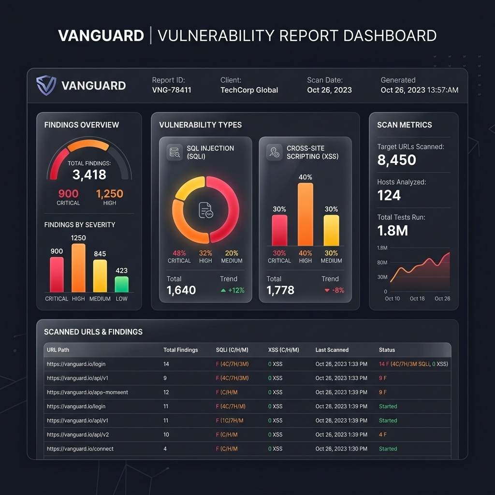

# Vanguard: Automated Web Vulnerability Scanner & Recon Tool 🛡️

[](https://www.python.org/)
[](https://opensource.org/licenses/MIT)
[]()
[]()

**Vanguard** is a premium, modular command-line vulnerability scanner designed for ethical hackers, security analysts, and developers. It crawls target websites, evaluates HTTP response security headers, and tests endpoints/forms for Cross-Site Scripting (XSS), SQL Injection (SQLi), Local File Inclusion (LFI), and OS Command Injection, generating interactive responsive HTML audit reports.

---

## 📸 Report Dashboard Preview


---

## ✨ Features
- **🌐 Target Crawling & Mapping:** Recursively crawls domains up to a configurable depth to discover endpoints, URLs, and active forms.
- **🔒 Security Header Audit:** Evaluates HTTP headers for missing parameters (`CSP`, `X-Frame-Options`, `HSTS`, `X-Content-Type-Options`) and flags dangerous version disclosures.
- **⚔️ Active Vulnerability Probing:**
  - **Cross-Site Scripting (XSS):** Param/form injection checks for parameter reflections.
  - **SQL Injection (SQLi):** Database driver exception check signatures.
  - **Local File Inclusion (LFI):** Traversal check seeking system config/credential exposure.
  - **OS Command Injection:** Shell operator auditing for arbitrary system code execution.
- **📄 Premium HTML Report:** Generates an interactive, styled HTML report with detailed remediation advice for every vulnerability found.

---

## 🎯 Vulnerability Audit Scope & Checks

The scanner runs checks across the following security vulnerability classifications:
*   **SQL Injection (SQLi)**: Probes inputs with database syntax triggers (e.g. `'`, `"`, `OR 1=1`) and monitors response buffers for MySQL, PostgreSQL, SQLite, and Microsoft SQL Server driver error leaks.
*   **Cross-Site Scripting (Reflected XSS)**: Injects HTML/JS snippets into parameters and audits response DOMs for unescaped mirrors.
*   **Local File Inclusion (LFI)**: Injects directory traversal strings (e.g. `../../../../etc/passwd` or `..\win.ini`) to check if the target reads files directly from unsanitized input parameters.
*   **OS Command Injection**: Injects shell command symbols (e.g. `;`, `|`) with diagnostic commands to see if the server environment executes them and returns system metadata.
*   **Missing Hardening Headers**: Checks for absent or misconfigured `Strict-Transport-Security` (HSTS), `Content-Security-Policy` (CSP), `X-Frame-Options` (Clickjacking protection), and `X-Content-Type-Options` (MIME sniffing prevention).
*   **Server Information Disclosure**: Inspects headers like `Server`, `X-Powered-By`, and `X-AspNet-Version` for leaks of server OS or runtime version numbers.

---

## 🚀 Step-by-Step Installation & Setup

### Step 1: Clone the Repository (Download karein)
Open your terminal and clone the repository:
```bash
git clone https://github.com/Neeshant01/vanguard-scanner.git
cd vanguard-scanner
```

### Step 2: Setup Virtual Environment (Venv configure karein)
Setting up a virtual environment avoids the `externally-managed-environment` error:
```bash
python3 -m venv venv
source venv/bin/activate
```

### Step 3: Install Dependencies (Packages install karein)
```bash
pip install -r requirements.txt
```

### Step 4: Run the Scan (Run karein)
```bash
# General Help options
python vanguard.py --help

# Run a scan and export report
python vanguard.py https://example.com -o audit_report.html
```

---

## 📖 Complete Setup & Troubleshooting Guide
For advanced debugging (e.g. fixing bs4 parsing limits or scanner blocks), read the [SETUP_GUIDE.md](./SETUP_GUIDE.md).

---

## 📄 License
Distributed under the MIT License.
