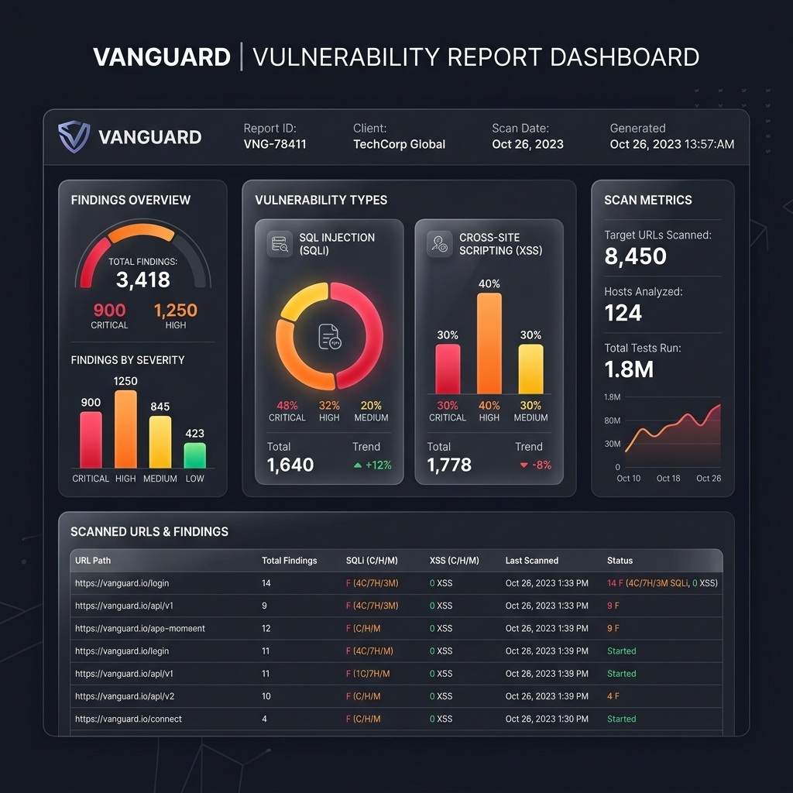
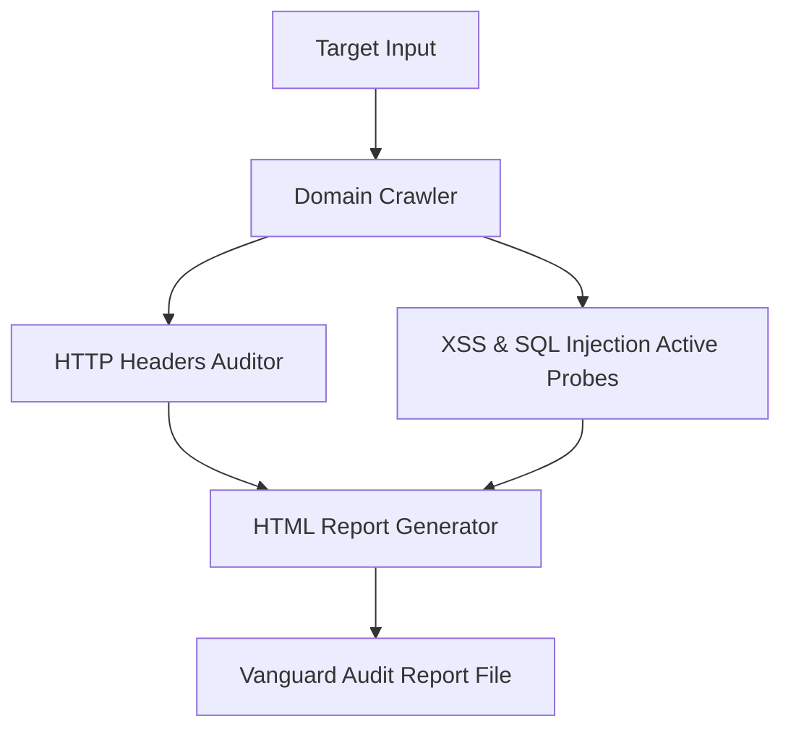

# Vanguard Vulnerability Scanner: Setup & Troubleshooting Guide

Follow these instructions to download, install, and execute the **Vanguard Web Security Scanner**.

---

## 1. Visual Overview & Architecture

### Vanguard HTML Report Dashboard


### Processing Diagram


---

## 2. Setup & Execution (Hindi + English)

### Step 1: Clone the Tool (Download karein)
```bash
git clone https://github.com/Neeshant01/vanguard-scanner.git
cd vanguard-scanner
```

### Step 2: Virtual Environment (Setup karein)
This avoids conflicts like `externally-managed-environment` on systems like Kali Linux:
```bash
python3 -m venv venv
source venv/bin/activate
pip install -r requirements.txt
```

### Step 3: Run the Scanner (Run karein)
```bash
python vanguard.py https://example.com -o target_report.html
```

---

## 3. Troubleshooting Errors (Dikkat Aaye Toh Kaise Fix Karein)

### Error 1: "externally-managed-environment" during pip install
- **Cause:** Linux (PEP 668) restricts global python package installations.
- **Fix:** Activate your virtual environment first:
  ```bash
  source venv/bin/activate
  ```

### Error 2: Connection Refused / Timeout
- **Cause:** The site is down, blocks automated scanners, or you used the wrong protocol.
- **Fix:** Double check if the target supports `https` or plain `http` and input accordingly:
  - `python vanguard.py http://vulntarget.com`

### Error 3: Empty Crawl Metrics / 0 pages audited
- **Cause:** The target is a Single Page Application (SPA) utilizing React/Vue/Angular which bs4 cannot crawl without javascript runtime execution.
- **Fix:** Run the scan on specific endpoint URLs directly.
