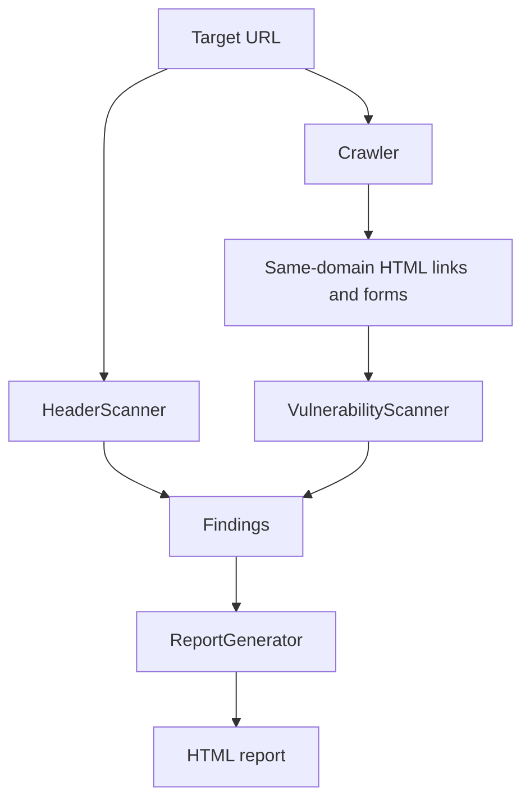

# Vanguard Scanner: Setup and Troubleshooting

This guide covers the current CLI and its known operating constraints. Read the safety notes before running active probes.

## Safety first

Run Vanguard only against systems you own or have explicit written permission to test. It sends test payloads to URL parameters and discovered HTML forms, including POST forms, so a scan can create or modify application data. Prefer a disposable or staging target and treat generated reports as sensitive.

The implementation does not authenticate, execute JavaScript, support a request allowlist/rate limit, or preserve a browser session. It uses a fixed five-second request timeout and disables TLS certificate verification in its request modules. Results therefore require manual review and are not a production security verdict.

## Install

```bash
git clone https://github.com/sudonishant/vanguard-scanner.git
cd vanguard-scanner
python3 -m venv .venv
source .venv/bin/activate
python -m pip install --upgrade pip
python -m pip install -r requirements.txt
```

On Windows PowerShell, activate with `\.venv\Scripts\Activate.ps1` instead. Python 3.8+ and Git are required. The project does not require environment variables or a configuration file.

## Run

Confirm the CLI without contacting a target:

```bash
python vanguard.py --help
```

Scan an authorized target and write an HTML report:

```bash
python vanguard.py https://example.com --depth 15 --output target_report.html
```

The positional target may omit `http://` or `https://`; the CLI defaults it to `https://`. `--depth` is the maximum number of pages visited (default 15). `--output` selects the report path (default `vanguard_report.html`). There is no `--timeout` flag; timeout values are currently fixed in the source.

## Processing overview



The entry point is `vanguard.py`. The crawler uses BeautifulSoup on server-rendered HTML; it does not run browser JavaScript. The vulnerability scanner performs active GET/POST checks for reflected XSS, SQL error signatures, LFI, command-injection response signatures, and simple SSTI patterns, and checks POST forms for likely hidden CSRF-token fields.

## Troubleshooting

### `externally-managed-environment` during installation

Activate the virtual environment before installing dependencies:

```bash
source .venv/bin/activate
python -m pip install -r requirements.txt
```

### Connection errors or timeouts

Check the target URL and network access. A target may be unavailable or may block automated requests. The scanner catches request failures internally, so an incomplete crawl or connection finding should not be treated as a clean result.

### Zero pages beyond the starting URL

The crawler only follows same-domain links found in returned HTML. Single-page applications and JavaScript-generated navigation are not rendered. Scan a known server-rendered endpoint directly and interpret the result as partial coverage.

### Unexpected state changes

Review forms on the authorized target before scanning. POST probes submit values to every discovered named input except submit/button controls; use a staging environment for state-changing workflows.

## Development checks

There is no automated test suite in this repository. Run the syntax check and, when installed, the same blocking lint subset used by CI:

```bash
python3 -m py_compile vanguard.py scanner/*.py
flake8 . --count --select=E9,F63,F7,F82 --show-source --statistics
```
